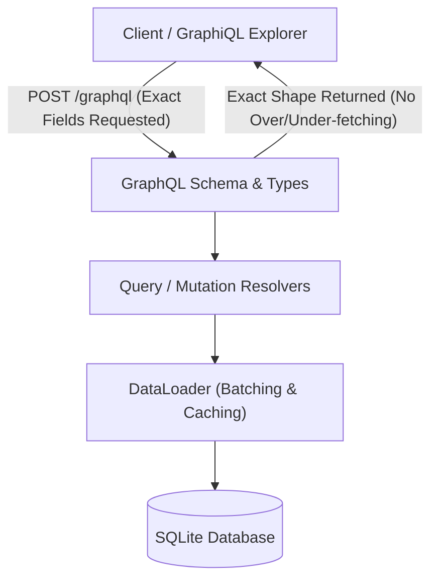

# DEV LOG: WEEK 41 - DAY 1

**Core Objective:** Kick off Week 41 (GraphQL API Server - PulseGraph) by defining domain models, planning the 7-day implementation roadmap, and scaffolding the complete backend and interactive explorer directory tree with 31 clean baseline files.

---

## 1. The Big Picture and Simple Explanation

In traditional REST APIs, client applications often struggle with two fundamental problems:
1. **Over-fetching:** The server returns a large JSON payload with 40 fields when the client only needs the user's name and avatar.
2. **Under-fetching:** To display a project page, the client must make 4 separate HTTP requests (`/api/projects/1`, `/api/users/5`, `/api/projects/1/reviews`, `/api/projects/1/technologies`).

**GraphQL** solves this by providing a single endpoint (`/graphql`) with a strongly typed schema. The client asks for exactly what it needs in a single query, and receives that exact shape in response.

This week, we are building **PulseGraph**, a production-grade GraphQL API server for developer portfolios, projects, and peer reviews:
- **Strongly Typed Schema:** Clear contract between client and server defining types, relationships, and operations.
- **Relational Resolvers & DataLoader:** Efficiently loads nested entities without suffering from the N+1 database query problem.
- **Relay-Style Pagination:** Reliable cursor-based pagination for project feeds.
- **Interactive Query Explorer:** An in-browser playground for testing and inspecting the live schema.



---

## 2. Directory Tree Scaffolding Created Today

A total of 31 baseline empty files across 11 modular packages were scaffolded and committed to Git folder-by-folder:

```
week41_graphql_server/
├── backend/
│   ├── app/
│   │   ├── config/
│   │   │   ├── __init__.py
│   │   │   └── settings.py
│   │   ├── graphql/
│   │   │   ├── __init__.py
│   │   │   ├── dataloaders.py
│   │   │   ├── mutations.py
│   │   │   ├── queries.py
│   │   │   ├── schema.py
│   │   │   └── types.py
│   │   ├── models/
│   │   │   ├── __init__.py
│   │   │   ├── project_model.py
│   │   │   └── user_model.py
│   │   ├── routes/
│   │   │   ├── __init__.py
│   │   │   ├── graphql_routes.py
│   │   │   └── health_routes.py
│   │   ├── __init__.py
│   │   └── db.py
│   ├── data/
│   │   ├── schema.sql
│   │   └── seed.py
│   ├── scripts/
│   │   └── run_quality_checks.py
│   ├── tests/
│   │   ├── __init__.py
│   │   ├── conftest.py
│   │   ├── test_graphql_mutations.py
│   │   ├── test_graphql_queries.py
│   │   └── test_health_routes.py
│   ├── requirements.txt
│   └── run.py
└── frontend/
    ├── public/
    │   └── index.html
    └── src/
        ├── assets/
        │   ├── base.css
        │   └── explorer.css
        ├── utils/
        │   └── helpers.js
        └── explorer.js
```

### Purpose of Key Modules

1. **GraphQL Domain Engine (`backend/app/graphql/`):**
   - `schema.py`: Compiles executable schema definitions, root query, and root mutation.
   - `types.py`: Defines Object Types (`User`, `Project`, `Review`, `Technology`), Enums, and custom scalars.
   - `queries.py`: Root query resolvers for fetching users, projects, and searches.
   - `mutations.py`: Root mutation resolvers for creating and updating entities.
   - `dataloaders.py`: Batching loaders to eliminate N+1 database queries.

2. **Data & Storage Layer (`backend/app/models/` & `backend/data/`):**
   - SQLite tables for users, projects, reviews, technologies, and project-tag associations.
   - Python models handling database access and business logic.

3. **Interactive Explorer Frontend (`frontend/`):**
   - In-browser GraphQL query playground allowing developers to test queries and inspect the live schema documentation.

---

## 3. Key Takeaways and Next Steps

- **Scaffolding Sets Clear Boundaries:** Establishing modular separation between GraphQL types, resolvers, and data models upfront ensures clean code organization.
- **Contract-First Development:** Defining types and schema rules before writing business logic ensures strong type safety and predictable API behavior.
- **Ready for Day 2:** With the file layout committed, Day 2 will define the GraphQL Type System, Schema Definition Language (SDL), custom scalars (`DateTime`), and Enums.
