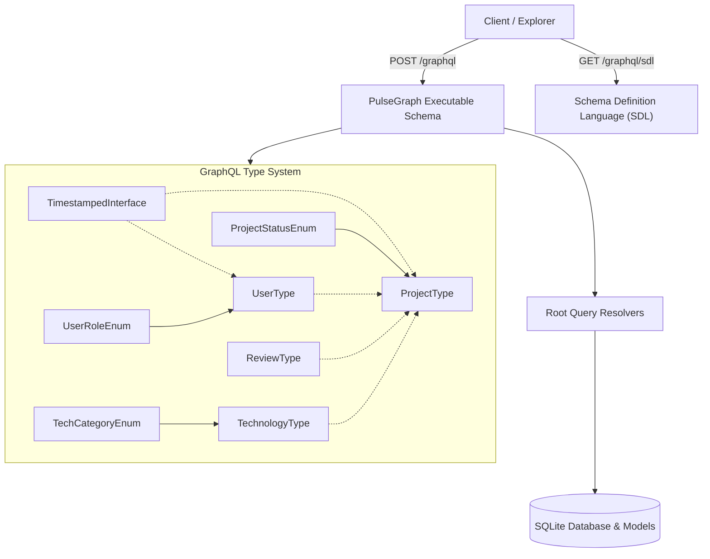

# DEV LOG: WEEK 41 - DAY 2

**Core Objective:** Design and implement the PulseGraph GraphQL Type System and core schema, including Object Types, Enums, Interfaces, Input Types, Schema Definition Language (SDL) compilation, SQLite relational storage, and comprehensive query test coverage with 5/5 quality gates passed.

---

## 1. The Big Picture and Simple Explanation

A GraphQL API is fundamentally a strongly typed contract. Unlike REST endpoints that return whatever arbitrary JSON structure a route function serializes, GraphQL requires every single piece of data to conform to a strict type definition.

Today, we built the foundational type system for **PulseGraph**:
1. **Enums:** Constrain fields to strict categorical values (`ProjectStatusEnum`, `TechCategoryEnum`, `UserRoleEnum`). This prevents typos or invalid state values at the boundary.
2. **Interfaces:** Define shared contracts (`TimestampedInterface` with `createdAt` and `updatedAt`). Both `UserType` and `ProjectType` implement this interface, guaranteeing consistent audit timestamps.
3. **Object Types:** Define entities and their relational fields (`TechnologyType`, `UserType`, `ProjectType`, `ReviewType`, `SystemStatsType`).
4. **Input Object Types:** Specify structured payloads for future mutations and filtering operations (`UserInput`, `ProjectInput`, `ReviewInput`, `ProjectFilterInput`).
5. **Schema Definition Language (SDL):** Compiled at runtime and exposed through `/graphql/sdl`, allowing developer tools and clients to introspect the complete schema.

---

## 2. Key Modules and Features Implemented Today

### A. GraphQL Type Definitions (`backend/app/graphql/types.py`)
- **Enums:**
  - `ProjectStatusEnum`: `DRAFT`, `ACTIVE`, `COMPLETED`, `ARCHIVED`.
  - `TechCategoryEnum`: `FRONTEND`, `BACKEND`, `DEVOPS`, `DATABASE`, `MOBILE`, `AI_ML`.
  - `UserRoleEnum`: `DEVELOPER`, `MAINTAINER`, `ADMIN`.
- **Interface:**
  - `TimestampedInterface`: Exposes `createdAt` (non-null string) and `updatedAt` (nullable string).
- **Object Types:**
  - `TechnologyType`: Identity, name, category enum, and icon slug.
  - `UserType`: Implements `TimestampedInterface`, fields for username, email, role, bio, and associated projects/reviews.
  - `ProjectType`: Implements `TimestampedInterface`, fields for title, description, status, stars count, owner, technologies, reviews, and average rating.
  - `ReviewType`: Rating (1-5), comment, author, and target project.
  - `SystemStatsType`: Aggregate platform analytics counters.
- **Input Types:**
  - Input object types prepared for mutation payloads and multi-parameter filtering (`ProjectFilterInput`).

### B. Executable Schema & Query Resolvers (`backend/app/graphql/queries.py` & `schema.py`)
- Defined the root `Query` class with resolvers:
  - `hello`: API greeting and availability probe.
  - `version`: Engine specification and semantic version string.
  - `stats`: Aggregate counters for users, projects, reviews, and technologies.
  - `technologies`: Supports optional `category` enum filter.
  - `users` & `user(id)`: Directory listing and single lookup.
  - `projects` & `project(id)`: Catalog query supporting `ProjectFilterInput` criteria.
- Assembled executable Graphene schema and runtime SDL generation utility (`get_sdl()`).

### C. Relational SQLite Schema & Seeder (`backend/data/`)
- `schema.sql`: Production SQLite relational tables with foreign keys and performance indexes:
  - `users`: Developer accounts with unique usernames and emails.
  - `technologies`: Frameworks and languages categorized by domain.
  - `projects`: Showcase projects linked to owners with cascading deletes.
  - `project_technologies`: Many-to-many junction table.
  - `reviews`: Peer review feedback with rating checks (1-5).
  - Performance indexes on `owner_id`, `status`, `project_id`, `author_id`, and `technology_id`.
- `seed.py`: Automated database seeder populating baseline technologies and developer accounts.

### D. Quality Gates & Pytest Coverage (`backend/tests/`)
- Created comprehensive test suite (`test_health_routes.py`, `test_graphql_queries.py`).
- Verified all 5 automated quality gates:
  - Flake8: 0 lint errors (max line length 88 characters).
  - Black: 100% formatted.
  - isort: All imports alphabetized and sectioned cleanly.
  - Bandit: 0 security vulnerabilities.
  - Pytest: 14 passing tests with 99.59% backend code coverage.

---

## 3. Key Takeaways and Next Steps

- **Strong Typing Eliminates Runtime Errors:** By declaring enums, interfaces, and scalar types upfront, queries are validated against the schema before execution, ensuring clients cannot request invalid shapes.
- **Pacing the Implementation:** Frontend implementation was kept at its clean Day 1 scaffolded state so that all attention on Day 2 was dedicated to the backend type system, query resolvers, database relations, and quality verification.
- **Ready for Day 3:** With the schema types, queries, and SQLite persistence established, Day 3 will introduce GraphQL Mutations (`createUser`, `createProject`, `updateProjectStatus`, `submitReview`) and data persistence resolvers.
