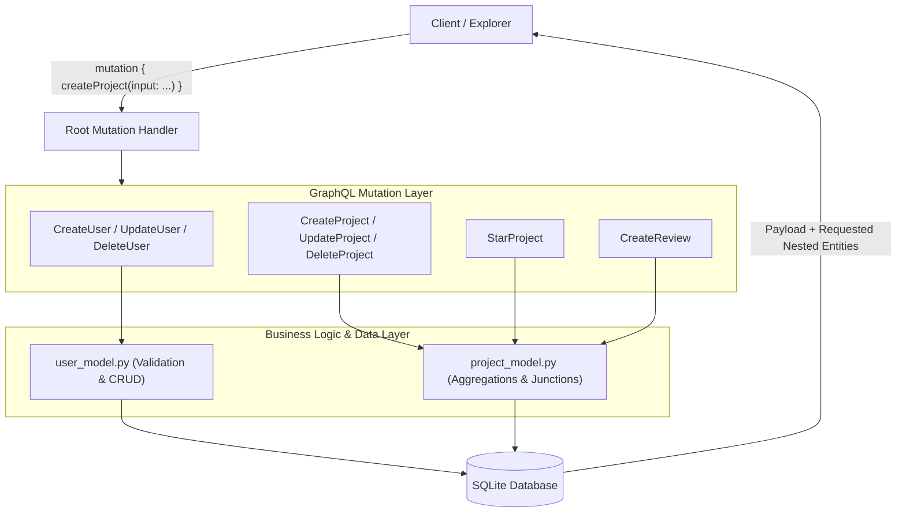

# DEV LOG: WEEK 41 - DAY 3

**Core Objective:** Implement GraphQL Mutations and business logic for PulseGraph, providing write operations for developer profiles, showcase projects, peer reviews, and stars with SQLite persistence, relational traversal resolvers, and automated test coverage passing 5/5 quality gates.

---

## 1. The Big Picture and Simple Explanation

In Day 2, we established the GraphQL read path (queries, types, enums, interfaces). However, an API that only reads data cannot support user interaction. Today, we built the write path using **GraphQL Mutations**.

In REST APIs, modifying data usually requires multiple endpoints with different HTTP verbs (`POST /api/users`, `PUT /api/projects/:id`, `DELETE /api/users/:id`, `POST /api/reviews`). In GraphQL, all state changes are orchestrated through a unified `Mutation` root type:
1. **Explicit Payloads:** Every mutation receives an input object and returns a structured payload containing the modified entity, a boolean `success` flag, and a human-readable `message`. This avoids silent failures.
2. **Atomic Relational Operations:** Creating a project automatically attaches tagged technologies in a junction table (`project_technologies`). Submitting a review automatically updates the project's rating metrics.
3. **Deep Relational Traversals:** Because mutations return rich GraphQL types, a client can create a project and immediately query its owner, tagged technologies, and reviews in a single request without round-trips.

---

## 2. Key Modules and Features Implemented Today

### A. Data Access & Business Logic Models (`backend/app/models/`)
- **Developer Model (`user_model.py`):**
  - Input validation for non-empty usernames, emails, and roles (`DEVELOPER`, `MAINTAINER`, `ADMIN`).
  - Parameterized SQLite queries preventing SQL injection vulnerabilities.
  - CRUD routines: `create_user`, `get_user_by_id`, `get_user_by_username`, `get_user_by_email`, `list_users`, `update_user`, `delete_user` (with foreign key cascading).
- **Showcase & Review Model (`project_model.py`):**
  - Project lifecycle operations: `create_project`, `get_project_by_id`, `list_projects`, `update_project`, `delete_project`, `star_project`.
  - Multi-parameter filtering in `list_projects` supporting search keywords, status, owner ID, technology ID, and minimum average rating.
  - Peer review handling in `create_review`: strict 1 to 5 integer validation, existence checks for target project and author.
  - Rating metrics aggregation: calculates `average_rating` and `review_count` using SQL group functions.

### B. GraphQL Mutations Layer (`backend/app/graphql/mutations.py`)
- Registered 8 production mutations on the root `Mutation` class:
  - `createUser`: Registers new developers with duplicate detection.
  - `updateUser`: Updates bio and permissions.
  - `deleteUser`: Removes profile and cascades related data.
  - `createProject`: Publishes showcase projects with tagged technology IDs.
  - `updateProject`: Modifies title, status, or technology stack.
  - `deleteProject`: Deletes projects and cascades reviews.
  - `starProject`: Increments repository appreciation stars.
  - `createReview`: Posts peer reviews with rating validation.

### C. Relational Resolvers (`backend/app/graphql/types.py`)
- Implemented nested field resolvers for seamless graph traversal:
  - `ProjectType`: `resolve_owner`, `resolve_technologies`, `resolve_reviews`.
  - `UserType`: `resolve_projects`, `resolve_reviews`, `resolve_project_count`.
  - `ReviewType`: `resolve_author`, `resolve_project`.

### D. Quality Gates & Pytest Coverage (`backend/tests/`)
- Implemented comprehensive mutation tests in `test_graphql_mutations.py` (22 test scenarios covering happy paths, duplicate errors, invalid ratings, not-found conditions, and deep relational traversals).
- Verified 5/5 quality gates via `python scripts/run_quality_checks.py`:
  - Flake8: PASS (0 lint warnings, max line length 88 characters).
  - Black: PASS.
  - isort: PASS.
  - Bandit: PASS (0 security vulnerabilities).
  - Pytest: PASS (36/36 tests passing with **95.33% backend coverage**).

---

## 3. Key Takeaways and Next Steps

- **Structured Payloads Prevent Ambiguity:** Returning `{ success, message, entity }` from every mutation makes client-side optimistic updates and error messaging predictable.
- **Relational Resolvers Pave the Way for DataLoader:** The nested resolvers implemented today demonstrate the power of GraphQL traversal, but also highlight potential N+1 query patterns when loading related entities in lists.
- **Ready for Day 4:** Day 4 will introduce **DataLoader** batching and caching mechanisms to eliminate redundant database queries during nested list resolutions.
