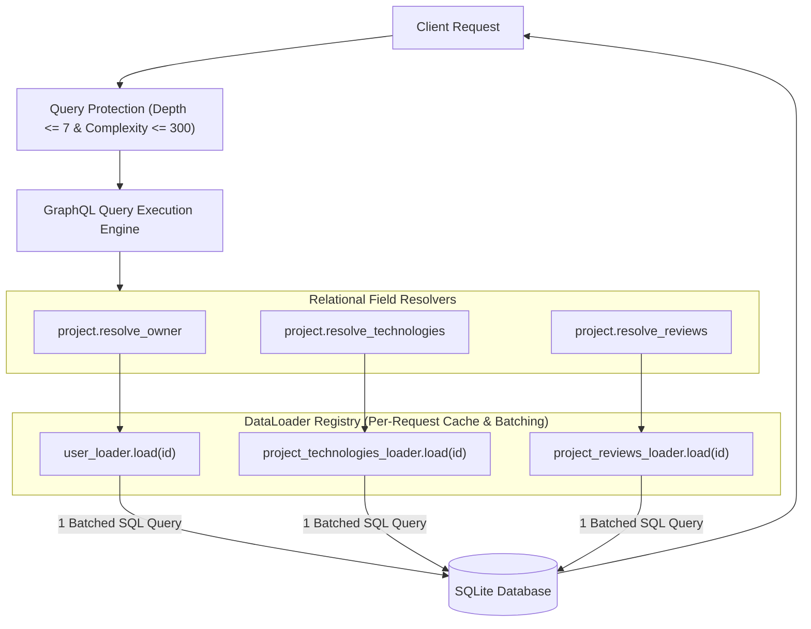

# DEV LOG: WEEK 41 - DAY 4

**Core Objective:** Implement request-scoped DataLoader batching and memoization to eliminate the N+1 query problem, introduce AST-based query depth and complexity safety validation to protect against Denial of Service, and expose execution performance metrics passing 5/5 quality gates.

---

## 1. The Big Picture and Simple Explanation

In Day 3, we built relational resolvers allowing clients to deeply traverse the graph (`user -> projects -> reviews -> author`). While expressive, this introduces the notorious **N+1 Query Problem**:
- If a client requests 10 projects and asks for each project's owner, a naïve resolver executes 1 query for the projects, followed by 10 separate queries for each owner (1 + 10 = 11 queries).
- When resolving tags and reviews across 100 projects, the server could fire hundreds of round-trips to the database for a single HTTP request, exhausting database connections and increasing latency.

Today, we solved this with **DataLoader and Query Optimization**:
1. **Batching:** Instead of fetching records individually, DataLoader queues keys during resolver execution and executes a single batched query using SQL `IN (?, ?, ...)` clauses.
2. **Request-Scoped Memoization Cache:** If multiple projects belong to the same developer (e.g. `owner_id: 1`), DataLoader queries that developer once and reuses the cached object for subsequent requests in the same turn.
3. **Query Depth and Complexity Limiting:** A custom AST analyzer measures nesting depth and cumulative complexity before execution, rejecting abusive cyclic queries before they consume database resources.
4. **Performance Extensions:** Queries return response `extensions` with duration metrics, complexity scores, and DataLoader hit rate statistics.

---

## 2. Key Modules and Features Implemented Today

### A. DataLoader Engine & Batch Loaders (`backend/app/graphql/dataloaders.py`)
- **Generic `DataLoader` Class:**
  - Implements `load(key)` with memoization cache and hit/miss tracking.
  - Implements `load_many(keys)` with deduplication and single-batch fetching.
  - Supports `prime(key, value)`, `clear(key)`, and `clear_all()`.
  - Exposes `get_stats()` reporting cache hits, misses, batch calls, and hit rates.
- **Specialized Entity Batch Loaders:**
  - `batch_load_users`: Batches developer lookups via `WHERE id IN (...)`.
  - `batch_load_projects`: Batches project lookups with rating aggregations.
  - `batch_load_technologies_for_projects`: Batches tagged technology joins.
  - `batch_load_reviews_for_projects`: Batches peer reviews grouped by project ID.
  - `batch_load_projects_for_owners`: Batches project showcases grouped by owner ID.
  - `batch_load_reviews_for_authors`: Batches author review histories.
- **`DataLoaderRegistry` Container:**
  - Provides a single request-scoped container initialized via `create_dataloaders()`.

### B. Query Protection & Complexity Analysis (`backend/app/graphql/protection.py`)
- **AST Depth Analyzer (`calculate_query_depth`):**
  - Recursively measures selection set nesting depth while ignoring meta fields.
- **Query Complexity Analyzer (`calculate_query_complexity`):**
  - Scores scalar fields (cost 1), object fields (cost 2), and list fields (cost 5 with child multiplier 2).
- **Safety Gate (`validate_query_safety`):**
  - Rejects queries exceeding `max_depth = 7` or `max_complexity = 300` before execution, preventing Denial of Service.

### C. Execution Pipeline & Middleware (`backend/app/routes/graphql_routes.py` & `types.py`)
- Injected `dataloaders` into GraphQL `context_value` on each HTTP request.
- Connected `UserType`, `ProjectType`, and `ReviewType` resolvers to request-scoped DataLoaders with fallback compatibility.
- Exposes `Server-Timing: gql;dur=...` header and `extensions` containing `duration_ms`, `depth`, `complexity`, and cache hit metrics.

### D. Automated Quality Gates & Testing (`backend/tests/`)
- Implemented `test_graphql_dataloaders.py` covering generic loader caching, batch queries, AST depth/complexity rejection, and performance headers.
- Verified all 5 automated quality gates via `python scripts/run_quality_checks.py`:
  - Flake8: PASS (0 lint warnings, max line length 88 characters).
  - Black: PASS.
  - isort: PASS.
  - Bandit: PASS (0 security vulnerabilities).
  - Pytest: PASS (44/44 tests passing with **92.37% backend coverage**).

---

## 3. Key Takeaways and Next Steps

- **Batching Eliminates Scalability Bottlenecks:** Replacing N individual queries with a single batched query reduces database latency by an order of magnitude for relational list queries.
- **Defensive API Design:** Enforcing depth and complexity limits at the API gateway protects production GraphQL servers from recursive query denial of service.
- **Ready for Day 5:** With robust, optimized backend queries, mutations, and DataLoaders in place, Day 5 will begin integrating the **Frontend GraphQL Client & Explorer Interface**.
