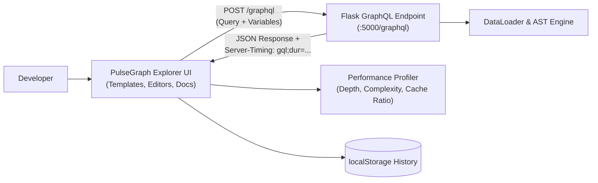

# Dev Log: Day 5 - Frontend GraphQL Client and Explorer Interface

**Date:** October 9, 2026  
**Phase:** Phase 3 - Production  
**Week:** Week 41 - GraphQL API Server (PulseGraph)  
**Status:** Completed  

---

## 1. The Big Picture and Simple Explanation

While traditional REST APIs rely on tools like Swagger or Postman for documentation and testing, GraphQL APIs provide a unified, self-documenting interface. Because the schema defines all types, queries, mutations, and fields upfront, client applications can introspect the entire server contract programmatically.

Today, we built the **PulseGraph Interactive GraphQL Explorer**, a zero-dependency, in-browser developer client and performance profiling dashboard. It connects directly to our Flask and Graphene backend (`/graphql` and `/graphql/sdl`), enabling engineers to:

1. **Explore Schema and Types:** Inspect queries, mutations, and object types rendered directly from the server's compiled Schema Definition Language (SDL).
2. **Execute Operations with Live Variables:** Write and run custom queries and mutations with parameterized JSON variables and synchronized line numbering.
3. **Inspect Real-Time Performance & Metrics:** Visualize query execution duration from `Server-Timing` headers, verify AST query depth limits, monitor complexity score budgets, and analyze DataLoader cache hit ratios.
4. **Manage Query History:** Automatically save executed operations to browser localStorage for immediate replay and testing.

---

## 2. What Was Built and Explored Today

### A. Client Execution Engine and Helpers (`frontend/src/utils/helpers.js`)
- **GraphQL Request Dispatcher (`executeGraphQL`):**
  - Sends structured JSON payloads containing `query`, `variables`, and optional `operationName`.
  - Captures high-resolution client roundtrip timing using `performance.now()`.
  - Parses `Server-Timing: gql;dur=...` HTTP response headers to isolate server-side processing from network latency.
  - Returns standardized payloads containing status codes, data, error arrays, extensions, and headers.
- **SDL Schema Loader (`fetchSchemaSDL`):**
  - Fetches the compiled plain-text SDL from the `/graphql/sdl` endpoint.
- **JSON Syntax Highlighter (`syntaxHighlightJson`):**
  - Formats and tokens JSON strings into colorized spans (keys, strings, numbers, booleans, and nulls) without third-party dependencies.
- **Query Templates Library (`QUERY_TEMPLATES`):**
  - Curated, production-ready operations covering project queries, developer profiles, platform analytics, project creation mutations, star toggles, peer reviews, DataLoader batching demos, and AST depth/complexity limit violation tests.
- **Persistent History Manager (`HistoryManager`):**
  - Automatically records up to 30 past queries with timestamps, execution durations, and HTTP status codes in localStorage.

### B. Dark Design System Tokens (`frontend/src/assets/base.css`)
- Cohesive dark palette engineered for developer tooling:
  - Surfaces: Primary `#0a0e17`, Secondary `#111827`, Surface `#151e2e`.
  - Accents: Indigo `#6366f1` (brand), Emerald `#10b981` (safe/success), Amber `#f59e0b` (warning), Rose `#ef4444` (rejection/error).
  - Typography: Monospace stack (`Fira Code`, `JetBrains Mono`, `Consolas`) optimized for code legibility.
  - Buttons, badges, and JSON syntax token classes.

### C. Workbench Layout and Performance Dashboard (`frontend/src/assets/explorer.css`)
- **Three-Pane Split Workbench:**
  - Left Drawer: Collapsible navigation for Templates, Schema Docs, and History.
  - Center Editor Pane: Monospace editor with synchronized line numbers gutter, status bar, and collapsible JSON Variables drawer.
  - Right Results Pane: Multi-tab view for Response, Performance Profiling, Schema SDL, and Response Headers.
- **Performance Dashboard Grid:**
  - Metric cards for Server Execution Duration, Client Roundtrip, DataLoader Cache Hit Ratio, AST Query Depth, and AST Query Complexity.
  - Detailed breakdown table of batch loads executed, in-memory cache hits, and cache misses.

### D. Semantic HTML5 Workbench Shell (`frontend/public/index.html`)
- Accessible layout with header endpoint bar, operation actions (`Run Query`, `Prettify`, `Explorer Pane`), editor containers, tabs, and connection status footer.

### E. Explorer Application Controller (`frontend/src/explorer.js`)
- Manages application state, endpoint configuration, line numbering synchronization, tab navigation, and keyboard shortcuts (`Ctrl+Enter` / `Cmd+Enter` to execute).
- Implements SDL parsing (`extractTypesFromSDL`) to dynamically generate Query, Mutation, and Object Type documentation with descriptions in the sidebar.
- Handles prettification of GraphQL queries and variables with JSON formatting.

---

## 3. Key Takeaways and Next Steps

- **Zero-Dependency Architecture:** Building a lightweight, custom GraphQL explorer without heavy external packages like GraphiQL or Apollo Studio ensures instant load times, full offline capability, and complete control over performance telemetry.
- **Transparent Observability:** Displaying DataLoader cache hit ratios alongside query depth and complexity scores in the UI makes the performance impact of GraphQL optimizations immediately visible to developers.
- **File-by-File Commits:** All frontend components were incrementally verified and committed file-by-file with zero emojis.
- **Ready for Day 6:** Day 6 will focus on **Authentication, Authorization Directives, and Permission Rules** across the GraphQL schema.
