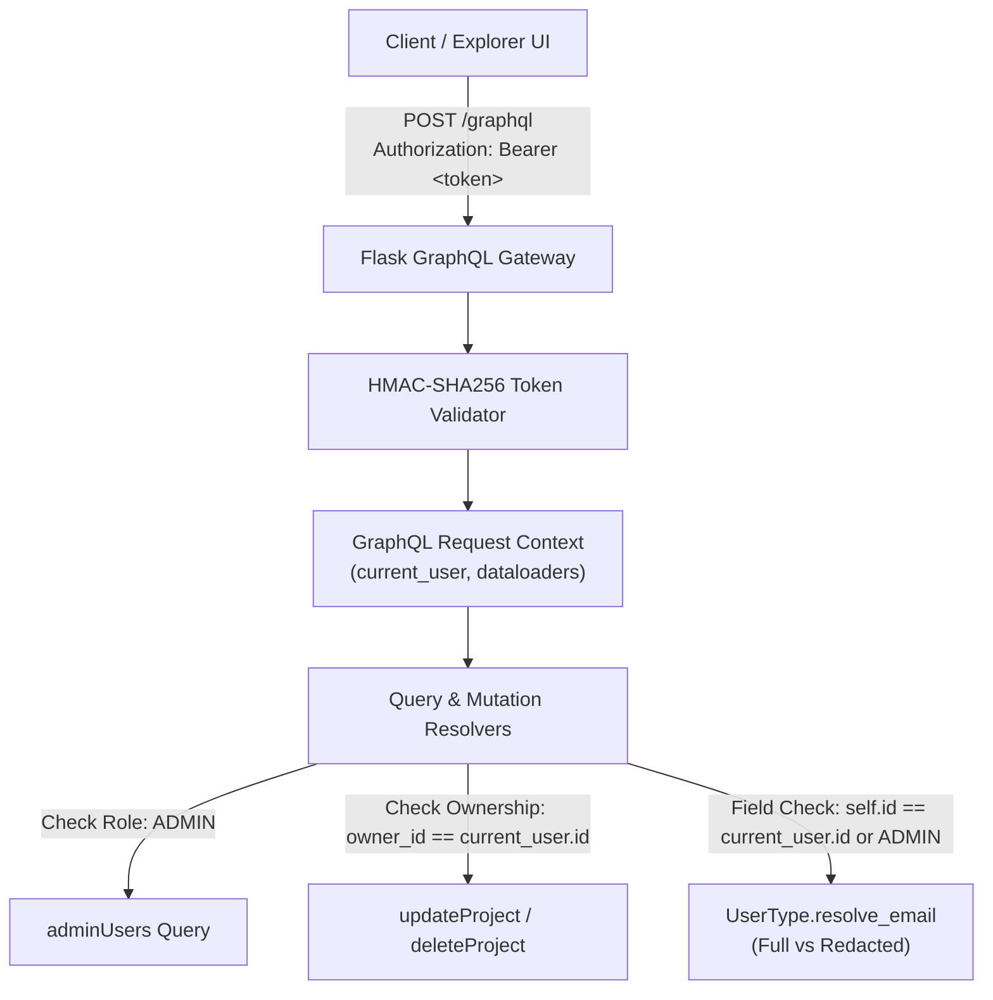

# Dev Log: Day 6 - Authentication, Authorization, and Field Permissions

**Date:** October 10, 2026  
**Phase:** Phase 3 - Production  
**Week:** Week 41 - GraphQL API Server (PulseGraph)  
**Status:** Completed  

---

## 1. The Big Picture and Simple Explanation

In traditional REST architectures, authentication and authorization are typically enforced at the endpoint URL level (for example, `/api/admin/*` or `/api/user/settings`). In GraphQL, however, the entire API is accessed through a single endpoint (`/graphql`). Clients can request any combination of fields, queries, and nested relations in a single HTTP POST request.

This introduces unique security requirements:
1. **Single Entry Point Authentication:** The API gateway must decode authentication credentials (such as an `Authorization: Bearer <token>` or `X-User-Id` header) and inject the resolved `current_user` into the request-scoped GraphQL execution context.
2. **Operation-Level Authorization (RBAC):** Mutations and root query fields must verify that the requester possesses the required system role (`DEVELOPER`, `MAINTAINER`, or `ADMIN`) or resource ownership before executing side-effects.
3. **Field-Level Permissions & PII Protection:** Sensitive entity attributes (such as developer email addresses) must not be exposed to arbitrary third parties. The type system must evaluate permissions at the individual field resolver level, redacting or returning full values dynamically based on who is asking.

Today, we implemented a production-grade, zero-dependency Authentication and Role-Based Access Control (RBAC) system for PulseGraph.

---

## 2. What Was Built and Explored Today

### A. Stateless HMAC-SHA256 Token Engine (`backend/app/graphql/auth.py`)
- **HMAC Bearer Token Generator (`generate_auth_token`):**
  - Generates tamper-resistant, hex-encoded signed tokens containing user ID (`sub`), `username`, system `role`, issue timestamp (`iat`), and expiration timestamp (`exp`).
  - Signed using HMAC-SHA256 with a dedicated server secret key.
- **Token Validator (`decode_auth_token`):**
  - Verifies cryptographic signatures using constant-time comparison (`hmac.compare_digest`) to prevent timing attacks.
  - Automatically validates token expiration timestamps (`exp`), rejecting stale or forged payloads.
- **Permission Decorators:**
  - `@require_auth`: Enforces presence of an authenticated `current_user` in execution context.
  - `@require_role(allowed_roles)`: Validates that `current_user.role` matches one of the allowed roles before invoking the resolver.
- **PII Email Redaction Utility (`redact_email`):**
  - Obfuscates email local parts for public unauthenticated views (`alex@example.com` becomes `a***x@example.com`).

### B. Field-Level Permissions and Computed Fields (`backend/app/graphql/types.py`)
- **Field-Level Redaction on `UserType.resolve_email`:**
  - Dynamically evaluates requester identity from context.
  - If the requester is the user themselves, or if the requester holds the `ADMIN` role, the full plaintext email is returned.
  - For unauthenticated requests or other developers, the email is automatically redacted.
  - Supports immediate unredacted viewing for profile creation and login mutations via `_unredacted` attribute tagging.
- **Computed Context Field `UserType.resolve_is_current_user`:**
  - Returns a boolean indicating whether the target user profile corresponds to the active authenticated session.

### C. RBAC Root Queries and Resolvers (`backend/app/graphql/queries.py`)
- **`viewer` Query:**
  - Exposes the currently authenticated developer profile from context, enabling client apps to query session state cleanly.
- **`adminUsers` Audit Query:**
  - Protected by strict RBAC validation. Access is permitted strictly to clients authenticated with the `ADMIN` system role. Unauthorized calls are rejected with a standardized `GraphQLError`.

### D. Authentication Mutations and Ownership Guardrails (`backend/app/graphql/mutations.py`)
- **`login` Mutation (`LoginUser`):**
  - Accepts `username` (or `email`), validates database existence, and issues an HMAC bearer token alongside the user entity.
- **Ownership Verification on Mutations:**
  - `updateProject`: Validates that the requester matches `project.owner_id` or holds the `ADMIN` role.
  - `deleteProject`: Restricts deletion to project owners or administrators.
  - `deleteUser`: Restricts developer profile deletion to the account owner or administrators.

### E. Gateway Header Extraction (`backend/app/routes/graphql_routes.py`)
- Ingests `Authorization: Bearer <token>` or `X-User-Id` headers on each incoming GraphQL request.
- Decodes and resolves the matching database record, injecting `current_user` into `context_value` alongside request-scoped DataLoaders.

### F. Frontend Explorer Authentication Integration (`frontend/`)
- Updated [index.html](file:///C:/Users/User/Documents/Github/Personal/VSCODE_PROJECT52/PROJECT52-PHASE3/week41_graphql_server/frontend/public/index.html) with a dedicated Bearer Token input bar.
- Updated [helpers.js](file:///C:/Users/User/Documents/Github/Personal/VSCODE_PROJECT52/PROJECT52-PHASE3/week41_graphql_server/frontend/src/utils/helpers.js) with `authToken` header injection and four dedicated **Auth** query templates:
  - Authenticate User (`login` mutation)
  - Current Authenticated Viewer (`viewer` query)
  - Field-Level Email PII Redaction Demo
  - Admin-Only User Audit (`adminUsers` query)
- Updated [explorer.js](file:///C:/Users/User/Documents/Github/Personal/VSCODE_PROJECT52/PROJECT52-PHASE3/week41_graphql_server/frontend/src/explorer.js) with automatic token capture on login mutation completion and localStorage token persistence.

### G. Automated Quality Gates and Test Suite (`backend/tests/test_graphql_auth.py`)
- Implemented 11 new automated test cases covering:
  - HMAC token signing, payload decoding, and tamper detection.
  - Expired token rejection.
  - Direct execution testing of `@require_auth` and `@require_role` decorators.
  - `login` mutation for valid and unknown users.
  - `viewer` query for anonymous, Bearer token, and `X-User-Id` clients.
  - Field-level email redaction for public vs self vs other vs admin requesters.
  - `adminUsers` RBAC rejection for anonymous and developer users, and grant for admin users.
  - Ownership protection on project update and delete mutations.
  - Ownership protection on user profile deletion.
- **Quality Gates Outcome:**
  - Flake8: PASS (0 lint warnings, 88-char limit).
  - Black: PASS.
  - isort: PASS (`--profile black`).
  - Bandit: PASS (0 security vulnerabilities).
  - Pytest: PASS (55/55 tests passing with **92.61% backend test coverage**).

---

## 3. Key Takeaways and Next Steps

- **Context-Driven Security:** Injecting authentication data into the execution context allows resolvers at any depth in the graph to make fine-grained authorization decisions without coupling business logic to HTTP framework handlers.
- **PII Defense in Depth:** Redacting sensitive fields at the type resolver level ensures that even if a client requests `users { email }`, confidential data is never leaked.
- **Zero External Dependencies:** Implementing HMAC-SHA256 bearer tokens with Python's standard library `hmac` and `hashlib` maintains minimal dependency footprint while providing full cryptographic integrity.
- **Ready for Day 7:** Day 7 will complete Week 41 with **Final Polish, End-to-End Integration Verification, and Production Handover Documentation**.
