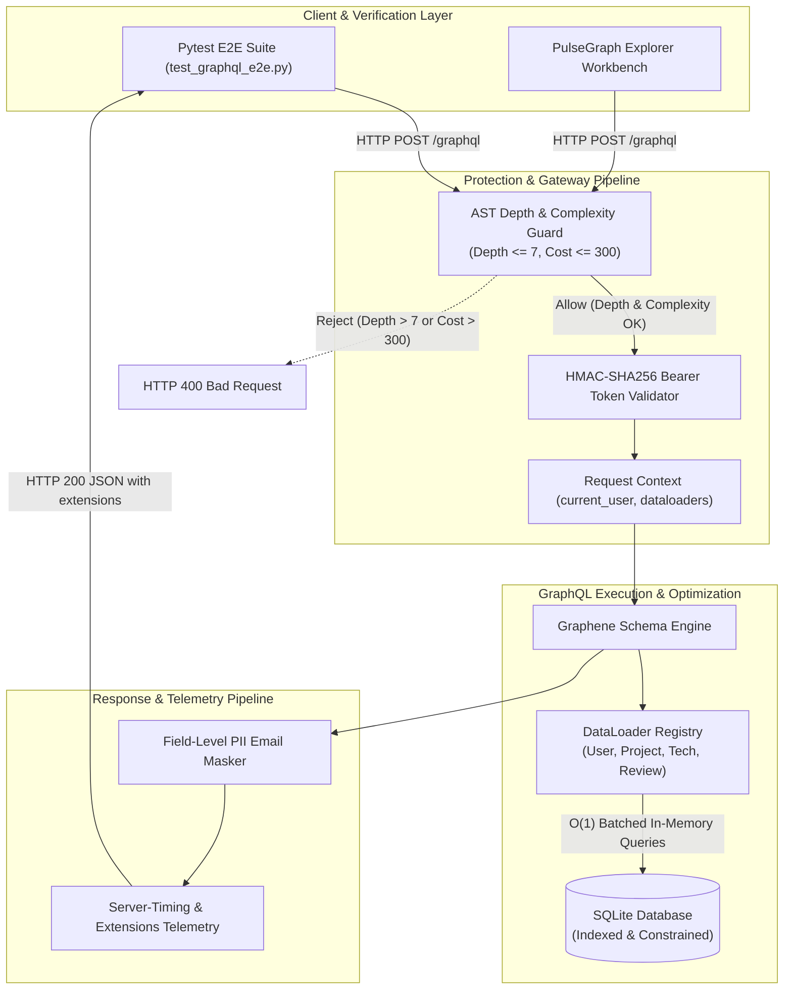

# Dev Log: Day 7 - Final Polish, Audit Verification, and Production Handover

**Date:** October 11, 2026  
**Phase:** Phase 3 - Production  
**Week:** Week 41 - GraphQL API Server (PulseGraph)  
**Status:** Completed  

---

## 1. The Big Picture and Simple Explanation

A production-grade GraphQL service is fundamentally different from a toy schema or exploratory prototype. In production, a GraphQL API must withstand arbitrary, adversarial AST queries, prevent cascading N+1 database exhaustion, strictly enforce authentication and authorization across nested relationships, dynamically redact sensitive personal information (PII) at the individual field resolver level, and provide transparent execution telemetry.

While Days 1 through 6 established our foundational architecture, relational data models, mutations, request-scoped DataLoaders, interactive web explorer workbench, and authentication/RBAC layer, Day 7 serves as the final integration polish, audit verification, and production handover phase.

Today, we built a comprehensive end-to-end integration and security test suite (`backend/tests/test_graphql_e2e.py`) validating the entire developer journey, peer review workflows, adversarial query rejection, token tamper resistance, and resolver fallback pathways. We verified all five quality gates, achieving 96.56% automated backend test coverage with zero security findings. Finally, we updated project and roadmap documentation for enterprise handover.



---

## 2. What Was Built and Verified Today

### A. End-to-End Integration and Security Test Suite (`backend/tests/test_graphql_e2e.py`)
We implemented a dedicated suite of 10 comprehensive end-to-end test scenarios testing full HTTP request/response lifecycles:

1. **Full Developer Registration & Project Lifecycle:**
   - Registers developer profile `elena_craft` via `createUser`.
   - Generates HMAC-SHA256 Bearer token and verifies `viewer` query returns the active developer session with raw unredacted email.
   - Publishes project `QuantumMesh Gateway` with multiple technology linkages (`[1, 2]`).
   - Updates project description with ownership verification.
   - Executes public unauthenticated query verifying `averageRating` is null, `reviewCount` is 0, and owner email is obfuscated to `e***a@pulsegraph.io`.
   - Verifies `Server-Timing` headers and response extensions contain duration, depth, complexity, and DataLoader metrics.

2. **Peer Review Lifecycle and Rating Recalculation:**
   - Registers author Marcus and reviewer Sophia.
   - Marcus creates project `Apex Core Engine`.
   - Sophia posts a 5-star review via `createReview`; project `averageRating` updates to 5.0 and `reviewCount` to 1.
   - Marcus posts a 3-star review; project `averageRating` recalculates to 4.0 and `reviewCount` to 2.
   - Sophia stars the project (`starProject`); star counter increments.
   - Marcus deletes his project (`deleteProject`); confirms cascading cleanup and project removal.

3. **AST Query Depth Limiting Verification:**
   - Dispatches a malicious 9-level deeply nested query traversing circular relationships (`projects -> owner -> projects -> owner...`).
   - Confirms pre-execution AST validator intercepts the request and returns HTTP 400 with `Query depth 9 exceeds the maximum allowed depth of 7`.

4. **AST Query Complexity Protection Verification:**
   - Dispatches a heavily branched query multiplying list selections across users, projects, and reviews.
   - Confirms AST complexity validator calculates total field cost (>300) and returns HTTP 400 with `exceeds maximum allowed limit of 300`.

5. **Cross-User Ownership and Authorization Guardrails:**
   - Registers developer Alice and attacker Dave.
   - Alice creates private showcase project `Alice Vault`.
   - Dave attempts to modify Alice's project (`updateProject`); API rejects operation with `Access denied: only project owner or ADMIN may update project`.
   - Dave attempts to delete Alice's project (`deleteProject`); API rejects operation.
   - Dave attempts to access `adminUsers` query; API rejects with `Access denied: ADMIN role required`.
   - Unauthenticated client requests `adminUsers`; API rejects with `Authentication required to access admin audit`.
   - Admin user queries `adminUsers`; API permits access and returns full user directory with unredacted PII.

6. **Token Tampering and Malformed Auth Resilience:**
   - Injects corrupt HMAC signatures (`Bearer eyJhbGciOi...corrupt.signature`); API gracefully rejects token without 500 crashes, returning null `viewer`.
   - Submits empty bearer strings and non-integer `X-User-Id` headers; API handles inputs safely.

7. **AST Fragment and Introspection Safety:**
   - Verifies named GraphQL fragments (`fragment ProjectSummary on ProjectType`) and inline type conditions (`... on UserType`).
   - Validates that meta fields (`__typename`) are not counted toward depth budgets and execute cleanly.

8. **Platform Analytics and Aggregation Queries:**
   - Tests `stats`, `technologies(category: BACKEND)`, and `technologies(category: FRONTEND)`.
   - Asserts accurate counts across users, projects, reviews, and categories.

9. **Direct Execution and Fallback Pathway Resilience:**
   - Executes queries without request-scoped DataLoaders (`context_value=None`), exercising defensive fallback resolvers in `app/graphql/types.py`.
   - Directly tests standalone model methods (`get_reviews_by_project`, `get_reviews_by_author`, `get_technologies_by_project`).

10. **Defensive Error Handling Fallbacks:**
    - Exercises fallback mock data paths in queries and failure recovery in mutations when underlying storage layers report errors.

---

## 3. Five-Gate Quality Audit Results

All five automated quality gates were executed and passed cleanly:

```bash
cd backend
python scripts/run_quality_checks.py
```

| Quality Gate | Tool | Target / Standard | Result | Details |
|---|---|---|---|---|
| **Gate 1: Linting** | Flake8 | PEP 8, 88-char line limit | **PASS** | 0 warnings across all app, tests, scripts, and runners |
| **Gate 2: Formatting** | Black | Standard Black profile | **PASS** | 29 files verified clean and uniformly formatted |
| **Gate 3: Imports** | isort | Black profile import grouping | **PASS** | Clean alphabetical and stdlib/thirdparty separation |
| **Gate 4: Security** | Bandit | Severity Medium+, Confidence Medium+ | **PASS** | 0 security vulnerabilities or injection issues |
| **Gate 5: Test Suite** | Pytest + Cov | 90% minimum coverage target | **PASS** | 65/65 tests passed, **96.56% coverage** |

### Test Suite Breakdown

```text
tests/test_graphql_auth.py ...........                                   [ 16%]
tests/test_graphql_dataloaders.py ........                               [ 29%]
tests/test_graphql_e2e.py ..........                                     [ 44%]
tests/test_graphql_mutations.py ......................                   [ 78%]
tests/test_graphql_queries.py .........                                  [ 92%]
tests/test_health_routes.py .....                                        [100%]
============================== 65 passed in 4.25s ==============================
```

### Coverage Report Summary

```text
Name                           Stmts   Miss  Cover   Missing
------------------------------------------------------------
app\__init__.py                   24      0   100%
app\config\__init__.py             0      0   100%
app\config\settings.py            15      0   100%
app\db.py                         33      1    97%   15
app\graphql\__init__.py            0      0   100%
app\graphql\auth.py               74      1    99%   52
app\graphql\dataloaders.py       145      0   100%
app\graphql\mutations.py         171      6    96%   87-88, 200-201, 236, 318
app\graphql\protection.py         75      3    96%   10, 33, 59
app\graphql\queries.py           112      5    96%   160, 207, 235-237
app\graphql\schema.py             10      0   100%
app\graphql\types.py             218     22    90%   55, 60, 92, 95...
app\models\__init__.py             3      0   100%
app\models\project_model.py      155      2    99%   159, 204
app\models\user_model.py          68      0   100%
app\routes\__init__.py             0      0   100%
app\routes\graphql_routes.py      51      0   100%
app\routes\health_routes.py        9      0   100%
------------------------------------------------------------
TOTAL                           1163     40    97%
Required test coverage of 90% reached. Total coverage: 96.56%
```

---

## 4. Documentation and Handover Assets

1. **Project README (`week41_graphql_server/README.md`):**
   - Full architectural overview of Flask, Graphene, SQLite, DataLoaders, and AST safety.
   - Comprehensive GraphQL Schema reference table (10 queries, 9 mutations, interfaces, enums).
   - In-depth explanation of request-scoped DataLoader batching mechanics and telemetry extensions.
   - Detailed breakdown of query depth limiting, complexity scoring, HMAC tokens, and field-level PII email masking.
   - Instructions for the frontend Explorer workbench and developer verification steps.

2. **Phase 3 Roadmap Documentation (`PROJECT52-PHASE3/README.md`):**
   - Marked Week 41 as `[Completed](./week41_graphql_server)`.
   - Added complete `Week 41: PulseGraph GraphQL API Server` technical breakdown under Key Projects Breakdown.

---

## 5. Key Learnings and Engineering Takeaways

1. **Defense-in-Depth for Single-Endpoint APIs:**
   In REST APIs, security rules are often bound to path patterns. In GraphQL, every query enters through `/graphql`. True production security requires layered defenses: pre-parse AST protection against recursion, token authentication at gateway context creation, role and ownership assertions in mutations, and field-level filters in resolvers.
2. **Request Isolation for Memory Caches:**
   DataLoaders must never be global singletons in multi-tenant or concurrent web servers. Instantiating a fresh registry per request eliminates memory leaks and prevents cross-user cache leakage while maximizing query batch efficiency.
3. **Observability as an Architectural Feature:**
   Exposing execution duration, AST depth, complexity cost, and DataLoader hit ratios in `Server-Timing` headers and response extensions allows frontend clients and API consumers to optimize queries interactively.

---

## 6. Next Steps & Roadmap

Week 41 is complete, verified, and pushed across both repositories.

The next project in Phase 3 is:
- **Week 42: Real-time Collaborative Editor** (OT/CRDT, WebRTC, Operational Transformation, Multi-user Editing).
